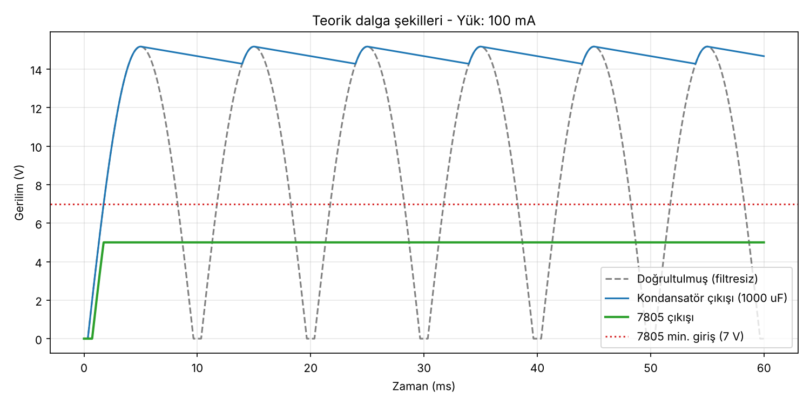
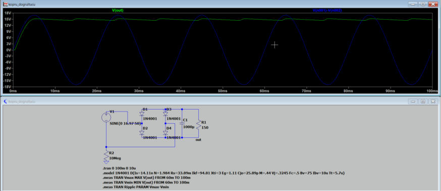

# AC-DC Güç Kaynağı Tasarımı (12 V AC → 5 V DC)

> **EN:** Design, simulation and (planned) breadboard implementation of a linear 5 V / 100 mA power supply: transformer, full-bridge rectifier (1N4001), capacitor filter and 7805 regulator. Hand calculations → LTspice simulation → real measurements.

Şebeke gerilimini elektronik devrelerin kullanabileceği sabit 5 V DC'ye dönüştüren doğrusal (lineer) bir güç kaynağının tasarımı. Proje üç aşamadan oluşur: **elle hesap → LTspice simülasyonu → breadboard üzerinde ölçüm.**

## Blok diyagram

```
230 V AC ──► [ Trafo ] ──► [ Köprü doğrultucu ] ──► [ Filtre C ] ──► [ 7805 ] ──► 5 V DC
  50 Hz       12 V rms      4x 1N4001                1000 µF          regülatör     100 mA
```

## Tasarım hedefleri

| Parametre | Değer |
|---|---|
| Giriş | 230 V / 50 Hz (trafo çıkışı 12 V rms) |
| Çıkış | 5 V DC |
| Yük akımı | 100 mA |
| İzin verilen dalgalanma (filtre çıkışı) | ≤ 2 V tepe-tepe |

## 1. Elle yapılan hesaplar

Hesapların tamamı [`hesaplamalar/tasarim_hesaplari.py`](hesaplamalar/tasarim_hesaplari.py) dosyasındadır.

| Adım | Formül | Sonuç |
|---|---|---|
| Trafo tepe gerilimi | V<sub>p</sub> = 12 · √2 | 16.97 V |
| Doğrultucu çıkışı | V<sub>p</sub> − 2·V<sub>D</sub> (köprüde 2 diyot iletimde) | 15.17 V |
| Dalgalanma frekansı | 2 · 50 Hz (tam dalga) | 100 Hz |
| Gereken kondansatör | C = I / (f · ΔV) = 0.1 / (100 · 2) | 500 µF → **1000 µF** seçildi |
| Gerçek dalgalanma | ΔV = 0.1 / (100 · 1000 µF) | 1.0 V |
| 7805 giriş kontrolü | 14.17 V (min) ≥ 7 V (5 V + 2 V dropout) | ✅ Uygun |
| 7805'te harcanan güç | (14.67 − 5) · 0.1 | ≈ 0.97 W |
| Diyot ters gerilimi | PIV = V<sub>p</sub> | 16.97 V (1N4001: 50 V ✅) |



**Gözlem:** Verim düşüktür (~%34), çünkü fazla gerilim 7805 üzerinde ısıya dönüşür. Bu, lineer regülatörlerin temel dezavantajıdır. İleride yapılacak **buck converter** projesi bu sorunu çözer.

## 2. LTspice simülasyonu

**Aşama 2a: Köprü doğrultucu ve filtre (regülatörsüz)**: [`simulasyon/kopru_dogrultucu.asc`](simulasyon/kopru_dogrultucu.asc)

Trafo, 16.97 V tepe değerli 50 Hz sinüs kaynağı ile modellendi. Yük olarak 150 Ω (≈100 mA) kullanıldı. Ölçümler, devre oturduktan sonraki 60–100 ms aralığında `.meas` komutlarıyla alındı.



*Mavi: trafo çıkışı (AC giriş). Yeşil: kondansatör üzerindeki DC çıkış.*

| Büyüklük | Elle hesap | LTspice | Fark |
|---|---|---|---|
| Çıkış tepe gerilimi | 15.17 V | 15.22 V | %0.3 |
| Çıkış minimum gerilimi | 14.17 V | 14.40 V | %1.6 |
| Dalgalanma (tepe-tepe) | 1.00 V | 0.82 V | %18 |

**Yorum:** Tepe gerilimi hesapla neredeyse birebir uyuşuyor. Dalgalanma ise simülasyonda daha düşük çıktı. Bunun nedeni, ΔV = I/(f·C) formülünün kondansatörün periyodun **tamamında** deşarj olduğunu varsaymasıdır. Gerçekte diyotlar her yarım periyodun bir kısmında kondansatörü yeniden şarj eder, yani deşarj süresi 10 ms'den kısadır. Ayrıca yük akımı, gerilim düştükçe 100 mA'in biraz altına iner. Bu yüzden formül **güvenli tarafta kalan** (kötümser) bir tahmin verir, ki tasarım için istenen de budur.

🔄 *Sıradaki adım:* 7805 regülatörünün eklenmesi ve farklı kondansatör değerleriyle (470 µF, 2200 µF) karşılaştırma.

## 3. Breadboard uygulaması ve ölçümler

⏳ *Planlandı:* düşük gerilim tarafının kurulumu ve multimetreyle yapılan ölçümler `olcumler/` klasörüne eklenecek.

## Klasör yapısı

```
├── hesaplamalar/   Python ile tasarım hesapları
├── simulasyon/     LTspice dosyaları (.asc) ve sonuç ekran görüntüleri
├── olcumler/       Gerçek devre ölçümleri ve fotoğraflar
└── gorseller/      README'de kullanılan grafikler
```

## Kullanılan araçlar

LTspice · Python (NumPy, Matplotlib) · Breadboard, dijital multimetre

---
*Dokuz Eylül Üniversitesi Elektrik-Elektronik Mühendisliği 2. sınıf, kişisel proje.*
